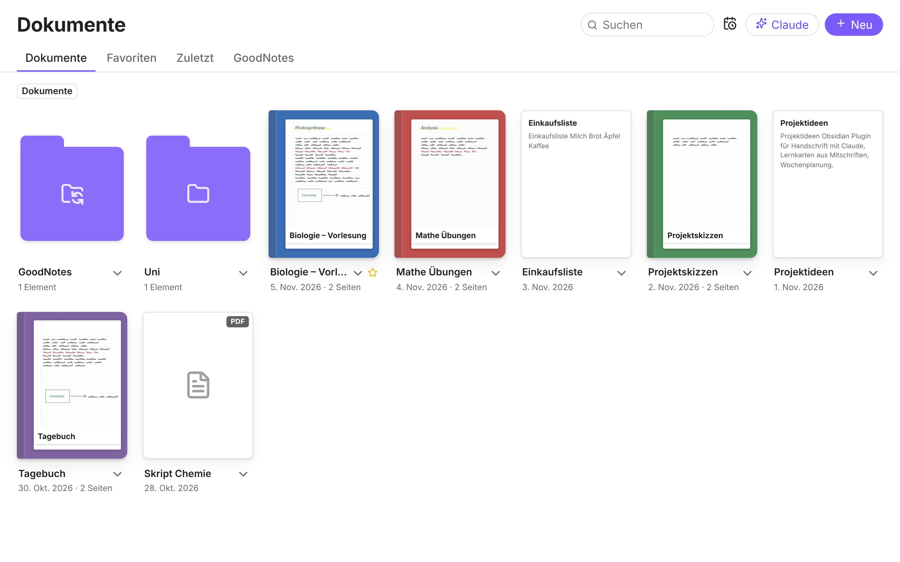
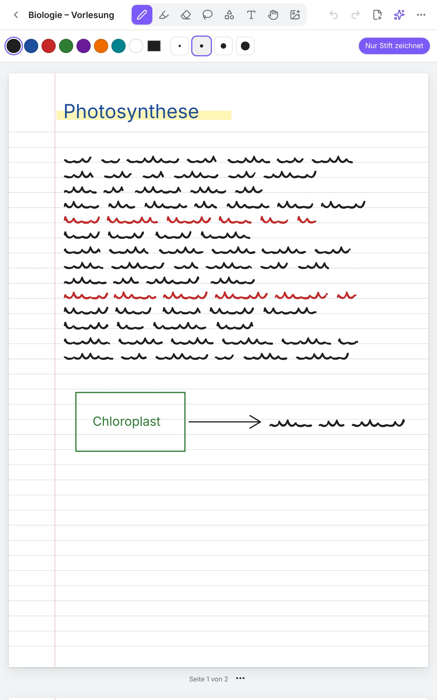

# Claude Notebook für Obsidian

Ein Obsidian-Plugin für das **Galaxy Tab S9 mit S Pen** (läuft auch auf iPad, Android und PC). Es hat vier Teile:

1. **Bibliothek:** Deine Ordner, Notizbücher, PDFs und Notizen als übersichtliches Raster mit Vorschaubildern, Favoriten, „Zuletzt“ und Suche. Es ersetzt die unübersichtliche Seitenleiste.
2. **Handschriftliches Notizbuch:** Schreiben mit dem S Pen (Druckstufen, Handballen-Erkennung, S Pen-Taste = Radierer), Textmarker, Lasso, Formen, Text, Bilder, Papiervorlagen, PDFs beschreiben und PDF-Export.
3. **Claude:** Entweder **ohne API** über deine Claude-App (Frage wird vorbereitet, Antwort mit einem Tipp übernommen), oder **mit API** als Assistent, der wie das Claude-Add-in in PowerPoint **direkt in deinen Notizen arbeitet**: Er sieht, was offen ist, schreibt, ändert, ordnet und liest deine Handschrift. Jede Änderung bestätigst du, und sie lässt sich rückgängig machen.
4. **GoodNotes-Verbindung:** Exportierte GoodNotes-Ordner (ZIP) und Notizbücher (PDF) importieren, mit Ordnerstruktur und Begleitnotiz je PDF. Neu exportierte Versionen werden erkannt.

| Bibliothek (Tab S9 quer) | Notizbuch (Tab S9 hochkant) |
|---|---|
|  |  |

**Anleitungen**
- [Einrichtung auf dem Galaxy Tab S9](docs/tab-s9.md): Schritt für Schritt, kein PC nötig
- [Das handschriftliche Notizbuch](docs/notizbuch.md): Werkzeuge, S Pen, PDFs und was GoodNotes noch besser kann
- [GoodNotes mit Obsidian verbinden](docs/goodnotes.md)
- [Andere Handschrift-Optionen](docs/handschrift.md) (Excalidraw, Ink, Samsung Notes) und [andere Claude-Anbindungen](docs/alternativen.md) (Claude-App mit MCP, Claudian, Claude Code)

---

## Was ist Obsidian?

[Obsidian](https://obsidian.md) ist eine Notiz-App für Windows, macOS, Linux, iPad/iPhone und Android.

- **Deine Notizen sind normale Dateien** in einem Ordner auf deinem Gerät, dem **Vault**. Es gibt keine Cloud-Pflicht.
- **Verlinken:** Mit `[[Notizname]]` verknüpfst du Notizen zu einem Wissensnetz.
- **Erweiterbar durch Plugins**, so wie dieses hier.
- **Kosten:** Obsidian ist kostenlos. Optional gibt es *Obsidian Sync* zum Synchronisieren zwischen Geräten.

---

## Installation (kurz)

Die ausführliche Anleitung für das Tablet steht in [docs/tab-s9.md](docs/tab-s9.md).

1. Obsidian aus dem [Play Store](https://play.google.com/store/apps/details?id=md.obsidian) installieren und einen Vault im **Gerätespeicher** anlegen.
2. *Einstellungen → Community-Plugins → Community-Plugins aktivieren → Durchsuchen* → **BRAT** installieren und aktivieren.
3. *Einstellungen → BRAT → Add Beta plugin* → `efn67tungtungtungsahur/Obsidian` eintragen.
4. *Community-Plugins* → **Claude Notebook** aktivieren. Die Bibliothek öffnet sich.

> BRAT installiert aus den GitHub-Releases. Ein Release entsteht automatisch, sobald in `manifest.json`
> eine neue Version steht (Workflow `.github/workflows/release.yml`). Das geht auch im GitHub-Web-Editor auf dem Tablet.

---

## Claude: zwei Modi

| | **Ohne API** (Standard) | **Mit API-Schlüssel** |
|---|---|---|
| Kosten | keine extra, dein Claude-Konto (kostenlos oder Abo) | pro Nutzung, getrennt vom Abo |
| Wo antwortet Claude? | in der Claude-App bzw. auf claude.ai | direkt in Obsidian |
| Ablauf | Frage vorbereiten → in Claude einfügen → Antwort kopieren → „Antwort einfügen“ | Frage stellen, fertig |
| Notizen bearbeiten | du fügst die Antwort ein | Claude ändert direkt, mit deiner Freigabe |
| Handschrift lesen | Seiten werden als Bild bereitgelegt, du hängst sie in Claude an | automatisch |

Umstellen: *Einstellungen → Claude Notebook → Modus*.

**Warum kann „ohne API“ nicht direkt in Obsidian arbeiten?** Anthropic erlaubt Plugins anderer Entwickler nicht, sich mit deinem Claude-Abo anzumelden. Das [Claudian-Plugin](docs/alternativen.md) umgeht das, indem es am PC das offizielle Claude Code startet. Auf Android geht das nicht. Auf dem Tablet braucht der „Claude arbeitet in deinen Notizen“-Modus deshalb einen API-Schlüssel.

### Beispiele mit API
- *„Fasse diese Notiz zusammen und schreib die Zusammenfassung oben hinein.“*
- *„Mach aus Seite 1 meines Notizbuchs eine saubere Notiz mit Überschriften.“*
- *„Erstelle 10 Karteikarten zu dieser Mitschrift als neue Notiz im Ordner Lernen.“*
- *„Recherchiere den aktuellen Stand zu Mikroplastik und ergänze einen Abschnitt mit Quellen.“*

Claude zeigt vor jeder Änderung eine Vorschau (*Bisher / Neu*) mit **Erlauben / Ablehnen**. Danach gibt es **Rückgängig** und **Öffnen**.

---

## Kosten (nur API-Modus)

Abgerechnet wird nach Tokens, Web-Suchen kosten zusätzlich ([Preise](https://www.anthropic.com/pricing)). Grobe Richtwerte mit Opus 5.5:
- einfache Frage: unter 1 Cent bis wenige Cent
- Recherche mit Web-Suche: etwa 5 bis 30 Cent
- eine handschriftliche Seite in Text umwandeln: etwa 1 bis 3 Cent

Sparen: in den Einstellungen *Sonnet 5.5* oder *Gründlichkeit: Mittel* wählen, für neue Themen einen neuen Chat starten und in der Anthropic-Konsole ein Ausgabenlimit setzen.

---

## Datenschutz & Sicherheit

- **Ohne API** geht nichts automatisch an Claude. Du entscheidest beim Einfügen in die Claude-App, was du teilst.
- **Mit API** gehen Anfragen direkt von deinem Gerät an `api.anthropic.com`. An Claude geht nur deine Frage, die geöffnete Notiz (wenn nötig) und was Claude über die Werkzeuge liest.
- **Änderungen an Notizen nur mit deiner Freigabe**, außer du schaltest „Änderungen ohne Nachfrage übernehmen“ ein. Alles ist rückgängig zu machen.
- Der API-Schlüssel liegt im Schlüsselspeicher von Obsidian, nicht im Vault.
- Webseiten und Notizen können versteckte Anweisungen enthalten (Prompt Injection). Claude behandelt sie als Material. Prüfe Vorschauen und Quellen trotzdem selbst.

---

## Entwicklung

```bash
npm install
npm test        # Offline-Tests: API, Agent, Notizbuch, PDF-Export, GoodNotes-Import (kein Schlüssel nötig)
npm run build   # Typprüfung + main.js
npm run dev     # Watch-Modus
```

| Datei | Inhalt |
|---|---|
| `src/main.ts` | Plugin-Einstieg: Ansichten, Befehle, Menüs, Verbindung der Teile |
| `src/library/` | Bibliothek (Raster, Vorschaubilder, Dialog „Neues Notizbuch“) |
| `src/notebook/` | Notizbuch: Datenmodell, Zeichnen (perfect-freehand), Ansicht mit Werkzeugen, PDF-Import/-Export |
| `src/goodnotes.ts` | GoodNotes-Import (ZIP/PDF), Begleitnotizen, Änderungserkennung |
| `src/agentTools.ts` | Werkzeuge für Claude: aktive Notiz, anlegen, ändern, ergänzen, verschieben, Notizbuchseite ansehen |
| `src/claude.ts`, `src/http.ts` | Claude-API: Streaming, Werkzeug-Schleife, Quellen, Fallback-Verbindung fürs Tablet |
| `src/chatView.ts` | Claude-Bereich: Chat, Freigabe- und Rückgängig-Karten, Modus ohne API |
| `src/appBridge.ts` | Modus ohne API: Frage vorbereiten, Claude öffnen, Antwort übernehmen |
| `src/notebookClaude.ts`, `src/transcribe.ts`, `src/attachments.ts` | Handschrift → Text |
| `test/` | Node-Tests und Browser-Testumgebung (`test/browser/`) für Bildschirmfotos |

Technik: offizielles `@anthropic-ai/sdk`, Claude Opus 5.5 mit adaptivem Denken, Web-Suche/Web-Fetch als Server-Werkzeuge, Prompt-Caching, `fallbacks: "default"` (abgelehnte Anfragen werden bei Opus/Sonnet serverseitig mit einem Ersatzmodell wiederholt).

## Lizenz

MIT
