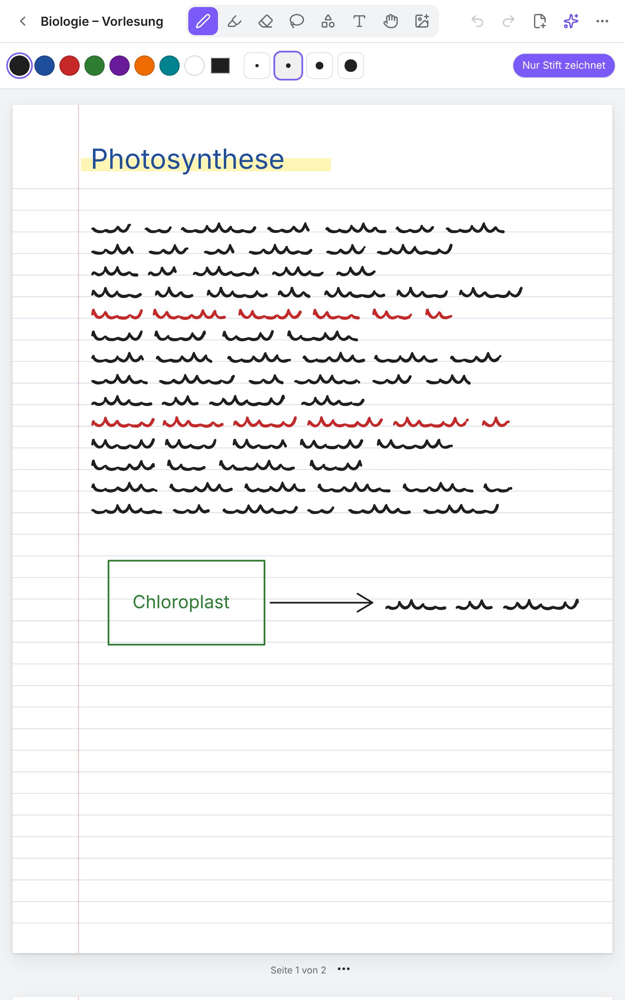

# Das handschriftliche Notizbuch

Das Plugin bringt ein eigenes **Notizbuch zum Schreiben mit der Hand** mit, gebaut für das Galaxy Tab S9 mit S Pen. Es funktioniert aber auch auf dem iPad, am PC mit Maus und auf jedem Android-Tablet.

Notizbücher sind Dateien mit der Endung `.notizbuch` in deinem Vault. Sie werden wie alles andere synchronisiert. Bei Obsidian Sync muss dafür unter *Einstellungen → Sync* die Option **„Andere Dateitypen synchronisieren“** an sein.

---

## Neues Notizbuch

**Bibliothek → „+ Neu“ → „Notizbuch (Handschrift)“**. Dann wählst du:
- **Titel**
- **Umschlagfarbe**
- **Papier:** Leer, Liniert, Kariert, Punktraster oder Cornell
- **Papierfarbe:** Weiß, Creme oder Dunkel

## Werkzeuge (Leiste oben)

| Symbol | Werkzeug | Was es macht |
|---|---|---|
| ✏️ | **Stift** | Schreibt mit Druckstufen des S Pen. Darunter wählst du Farbe (8 Farben + eigene) und 4 Stärken. |
| 🖍️ | **Textmarker** | Halbtransparent, liegt *unter* der Schrift. 5 Farben, 3 Breiten. |
| 🧽 | **Radierer** | Über Striche wischen löscht sie. |
| ➰ | **Lasso** | Striche, Text und Bilder einkreisen. Danach **verschieben** (in die Auswahl tippen und ziehen), **umfärben**, **duplizieren** oder **löschen**. |
| 🔷 | **Formen** | Linie, Pfeil, Rechteck, Ellipse: einfach aufziehen. |
| T | **Text** | Auf die Seite tippen, Text eingeben. Das geht auch mit „S Pen zu Text“. |
| ✋ | **Hand** | Seiten verschieben (praktisch mit Maus). |
| 🖼️ | **Bild** | Foto aufnehmen, aus der Galerie oder aus dem Vault einfügen. Mit dem Lasso verschiebst du es. |

Rechts in der Leiste: **Rückgängig / Wiederholen**, **Seite hinzufügen**, das **Claude-Menü ✨** und **„⋯“** für Papierfarbe, Umschlag, PDF-Export, Seite als Bild und Zoom zurücksetzen.

## S Pen und Finger

- **„Nur Stift zeichnet“** (Schalter rechts in der zweiten Leiste, auf Tablets standardmäßig an): Nur der S Pen schreibt. **Ein Finger scrollt**, **zwei Finger zoomen**.
- **Handballen-Erkennung:** Solange der Stift schreibt oder über dem Display schwebt, werden Berührungen ignoriert. Du kannst die Hand also beim Schreiben ablegen.
- **S Pen-Taste gedrückt halten = Radierer**, egal welches Werkzeug gerade gewählt ist.
- Rückgängig geht auch mit Tastatur-Cover: **Strg+Z** und **Strg+Umschalt+Z**.

## Seiten

- Unter jeder Seite: **„Seite X von Y“** und **„⋯“** für *Neue Seite danach*, *Duplizieren*, *Vorlage ändern*, *Nach oben/unten* und *Löschen*.
- Ganz unten: **„Seite hinzufügen“** mit Vorlagenwahl.
- Die Seiten scrollen untereinander, wie in GoodNotes mit vertikalem Scrollen.

## PDFs beschreiben

- **Bibliothek → „+ Neu“ → „PDF zum Beschreiben“**: Die PDF wird zum Notizbuch, und jede PDF-Seite ist ein Blatt, auf das du schreibst.
- In einem bestehenden Notizbuch: **„Seite hinzufügen“ → „PDF-Seiten einfügen“**.
- In der Bibliothek bei einer PDF: **„⋯“ → „Zum Beschreiben öffnen“**.

Die PDF selbst bleibt unverändert. Deine Schrift liegt im Notizbuch darüber.

## Exportieren

- **„⋯“ → „Als PDF exportieren“**: Erzeugt `Name.pdf` im selben Ordner, mit allen Seiten.
- **„⋯“ → „Aktuelle Seite als Bild speichern“**: PNG der aktuellen Seite.

## Claude im Notizbuch (✨)

- **„Diese Seite in Text umwandeln“** und **„Ganzes Notizbuch in Text umwandeln“**: Claude liest deine Handschrift, auch Formeln und Skizzen. Der Text landet in der Notiz **„Name (Text)“** daneben. Damit ist deine Handschrift über die Obsidian-Suche **auffindbar und verlinkbar**.
- **„Frage zu dieser Seite …“**: Zum Beispiel „Erkläre mir die Formel unten“ oder „Mach daraus Karteikarten“.

Das funktioniert in beiden Modi:
- **Ohne API:** Das Plugin speichert die Seiten als Bilder in `Name – Seiten/` und öffnet Claude. Du hängst die Bilder dort an. Danach übernimmst du die Antwort mit **„Claude-Antwort einfügen“ → „Als Text zu Seite …“** direkt ins Notizbuch.
- **Mit API:** Alles läuft automatisch in Obsidian.

---

## Ehrlich: Was GoodNotes (noch) besser kann

Ein Plugin kann eine über Jahre entwickelte App nicht in allem ersetzen. Fehlen tun im Moment:

| Funktion | Stand hier |
|---|---|
| Teilradierer (nur ein Stück eines Strichs löschen) | nur ganze Striche |
| Formerkennung („Kreis malen und halten → perfekter Kreis“) | eigenes Formen-Werkzeug zum Aufziehen |
| Auswahl drehen oder vergrößern | nur verschieben, umfärben, duplizieren, löschen |
| Textfelder nachträglich bearbeiten | löschen und neu setzen |
| Handschrift-Suche ohne Umwandlung | über „In Text umwandeln“ mit Claude, danach voll durchsuchbar |
| Seitenübersicht als Raster, Lesezeichen, Gliederung | Seiten untereinander, Seitenmenü pro Seite |
| Audioaufnahme, Laserpointer, Sticker, Zusammenarbeit | nicht vorhanden |
| Querformat-Seiten, Doppelseiten | nur Hochformat (bzw. Format der PDF) |

Dafür kann es, was GoodNotes nicht kann: Deine Handschrift liegt neben deinen Obsidian-Notizen, ist verlinkbar und durchsuchbar, Claude kann sie lesen und weiterverarbeiten, und das Dateiformat ist offen (JSON).
